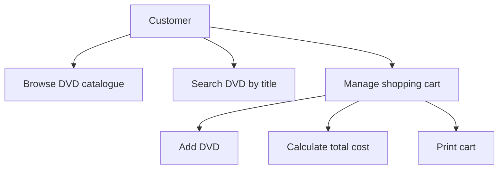

# AIMS-mini use cases

## Main flow
1. The customer browses or searches the DVD catalogue.
2. The customer adds selected DVDs to the cart, subject to the 20-item limit.
3. The application displays the cart and calculates its total cost.
